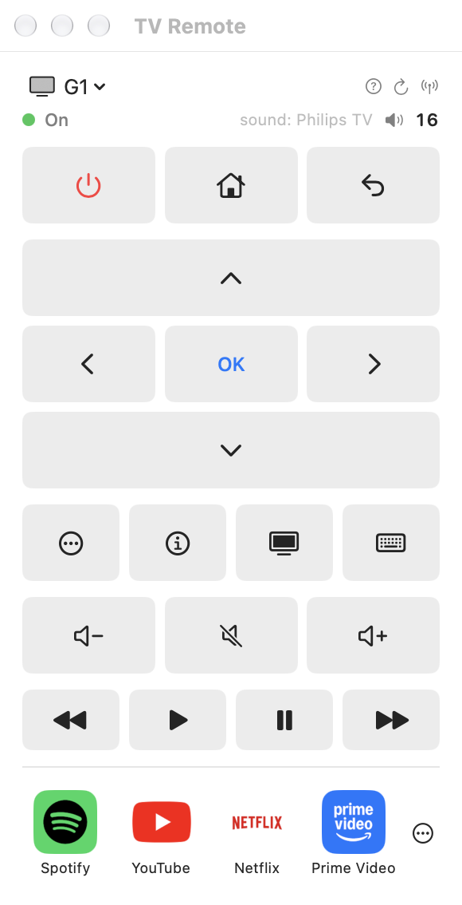

# TV Remote for Mac

A native macOS remote for the TVs in your home: Philips (JointSpace), Apple TV and
Android TV / Google TV, side by side in one small window or in the menu bar. Drive them with
the mouse, the keyboard or the Mac's media keys, type into search fields on the TV, and add
support for other TVs with a driver written in any language.

<p align="center"></p>

## Features

- **Several TVs.** Switch with the TV menu or ⌘1–⌘9; add more with "Add TV…" (⌘N). TVs are
  found on the local network; an IP address can be typed in as well.
- **Full keyboard control.** Arrows, Return = OK, Esc/⌫ = Back, Space = Play/Pause. Keys can be
  held to repeat; press `?` for the full list.
- **Mac media keys.** F7 / F8 / F9 rewind, play/pause and fast-forward on the TV.
- **Play/pause state** (optional, per TV in Settings → TVs). The Mac's Now Playing shows
  whether the TV plays or is paused: Apple TV over a second AirPlay link (one more PIN when
  pairing), Android TV over ADB (network debugging on). Off, the TV always shows as playing.
- **Typing.** `K` opens a text field whose contents go to the selected field on the TV as you
  type, so you don't have to pick letters from an on-screen keyboard (Apple TV, Android TV).
- **Sound from another TV.** A box on a TV's HDMI input (e.g. a Google TV box on a Philips) can
  send volume and mute to that TV: TV menu → "Sound Plays On".
- **Apps.** The most recently used apps as tiles, plus a menu of all known apps (Apple TV,
  Android TV). Ambilight styles on Philips.
- **Window, menu bar or both**, with or without a Dock icon.
- **Drivers.** Support for another kind of TV is a folder with a manifest and a program that
  speaks JSON lines over stdin/stdout. See [DRIVERS.md](DRIVERS.md).

## Supported TVs

| Driver | Works | Does not work |
|---|---|---|
| Philips (built in) | Titan OS models (2024+, e.g. PUS7009, PUS8009, PUS8109, PUS8309, PUS8919), tested on a 65PUS8919. Philips Android TVs from about 2016 on (port 1926) should work; untested. | Pre-2016 Philips TVs (port 1925, no pairing). On Titan OS: app list and HDMI input switching (the API answers 403). |
| Apple TV ([pyatv](https://pyatv.dev)) | Apple TV HD and 4K with tvOS 15+; tested on an Apple TV 4K (3rd gen) | Apple TV 3 and older; volume level |
| Android TV / Google TV ([androidtvremote2](https://github.com/tronikos/androidtvremote2)) | Devices that work with Google's TV remote app: Sony, TCL, Hisense, Philips and Sharp Android TVs, Chromecast with Google TV, Google TV Streamer, Nvidia Shield, set-top boxes. Tested on an SDMC G1 box. | Fire TV; Cast-only Chromecasts; listing installed apps (the menu offers popular apps) |

Details are in the app: Settings → Supported TVs.

## Requirements

- macOS 15 or later, Apple silicon
- Xcode Command Line Tools (`xcode-select --install`) to build
- For Apple TV and Android TV: Python 3. The app installs each driver's packages into its own
  virtual environment (Settings → Supported TVs → Install), with
  [uv](https://docs.astral.sh/uv/) if it is installed, otherwise `python3 -m venv` and pip.
  An existing `pipx install pyatv` is used as is.

## Build and run

```bash
./build.sh
open ~/Applications/"TV Remote.app"
```

`build.sh` compiles `App/*.swift` with `swiftc` (no Xcode project) into
`~/Applications/TV Remote.app` and signs it ad hoc. On first launch macOS asks for access to
the local network; the app needs it to find and control TVs.

Pair a TV: it must be on and on the same network. Pick it from the list and type the PIN shown
on screen. An Apple TV already paired with `atvremote` (`~/.pyatv.conf`) is added without a PIN.

## Keyboard

| Key | Action |
|---|---|
| ↑ ↓ ← → | Navigate (hold to repeat) |
| Return | OK |
| Esc, ⌫ | Back |
| Space | Play / Pause |
| H, O, I, S | Home, Options, Info, Source |
| P | Pause |
| , . | Rewind, fast-forward |
| − + | Volume (hold to repeat) |
| M | Mute |
| K | Type text on the TV |
| A | Next Ambilight style (Philips) |
| ⌘P | Power on / standby |
| ⌘R, ⌘L | Refresh status, find the TV on the network again |
| ⌘1–⌘9 | Switch TV |
| F7 F8 F9 | Rewind, play/pause, fast-forward (Mac media keys) |
| ? | Shortcut sheet |

Keys go to the TV only from the remote itself, never while typing in a text field, from
Settings or from the pairing screen. Buttons a TV does not have are hidden.

The media keys work through macOS "Now Playing" (no Accessibility permission needed). An app
that starts playing (Music, a video in a browser) takes them over. Turn this off in
Settings → General.

## How it works

| Path | What |
|---|---|
| `App/Core.swift` | Shared types: `TVDriver` (a kind of TV), `TVConnection` (one TV), `TVStore` (paired TVs) |
| `App/Philips.swift` | Built-in Philips driver: JointSpace v6 over HTTPS, digest auth, PIN pairing, port scan on 1926 |
| `App/ScriptDriver.swift` | External drivers: one long-running process per driver, JSON lines over stdin/stdout |
| `App/Bonjour.swift` | Bonjour discovery on behalf of external drivers |
| `App/Model.swift` | State, ordered command queue, keyboard routing |
| `App/Views.swift`, `App/Settings.swift`, `App/TVRemoteApp.swift` | SwiftUI interface, settings, menus |
| `App/MediaKeys.swift` | Mac media keys via `MPRemoteCommandCenter` |
| `Drivers/appletv/` | Apple TV driver (pyatv, Companion protocol) |
| `Drivers/androidtv/` | Android TV / Google TV driver (Android TV Remote protocol v2) |
| `make-icon.swift` | Draws `AppIcon.icns` in code |
| `cli/` | Command-line tools for Philips TVs, see [cli/README.md](cli/README.md) |

Commands go to a TV one at a time and in order, so a quick ↓ ↓ → arrives as typed; a held
arrow key never queues up moves, so the cursor stops when the key is released. Volume changes
coalesce into one request with the latest value.

The app does the Bonjour discovery for external drivers and hands them addresses, so no driver
process listens on a port and the macOS firewall never asks about Python. Driver logs go to
`~/Library/Logs/TV Remote/<id>.log`.

When a TV stops answering (a new DHCP lease, a new router), the app looks for it again by its
device id and saves the new address.

## Files and security

- Paired TVs and their credentials: `~/Library/Application Support/TV Remote/tvs.json`
  (mode 600). Driver data (Android TV client certificate and key, app logos):
  `~/Library/Application Support/TV Remote/<driver>/`.
- The active Philips TV is mirrored to `~/.config/philips-tv/config.json` for the CLI, and a TV
  paired with the CLI shows up in the app.
- Philips TVs use a self-signed certificate on port 1926, so certificate checks are off for
  them. Fine on a home network, but not protection against someone on the same network.
- Apple TV credentials are kept by pyatv in `~/.pyatv.conf`.

## Status

Tested on real devices: the remote buttons, pairing and discovery for Philips (65PUS8919) and
Android TV (SDMC G1), connecting to an Apple TV 4K, app tiles on Android TV.

Not yet tested on a TV: typing, sound from another TV, the media keys, pairing a new Apple TV
or Philips from the app, the menu-bar-only mode. Reports are welcome.

## Writing a driver

Copy `Drivers/appletv` or `Drivers/androidtv`, change `driver.json` and the program, and put
the folder into `~/Library/Application Support/TV Remote/Drivers/` (Settings → Supported TVs →
Open Drivers Folder). The protocol is in [DRIVERS.md](DRIVERS.md).

## License

[MIT](LICENSE)
